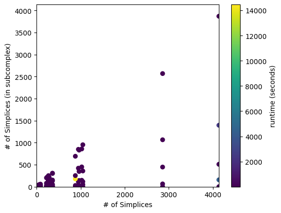

# Description

This repository utilizes the [Open Applied Topology](https://github.com/pnnl/oat_pnnl) project to implement a method to compute persistent relative homology via the [U-match Decomposition](https://arxiv.org/abs/2108.08831).

To see a prior implementation of a special case, see [this](https://github.com/ChristianLentz/Umatch_PersistentRelativeHomology) repository.

## Contributions

The original work in this repository is as follows:

- **umatch.py** implements U-match decomposition. It requires a sparse LIL matrix optimiozed for row operationsa and returns a SciPy CSC matrix.
- **generate_data.py** includes methods generate data for testing and format for use with our implemented algorithm.
- **plot.py** includes methods to plot data and barcode decompositions.
- **bifiltered_simplices.py** implements two data structures: a bifiltered simplex and a bifiltered simplicial complex. That is, a simplicial complex in which each simplex contains a diameter and an (optional) subcomplex diameter of equal or greater value. This file is key to this project.
- **boundary_matrix.py** constructs a so-called relative boudnary matrix via a permutation of a standard Vietoris-Rips boundary matrix, and includes hash maps for constant time look-up operations with respect to two different total orders on indexing sets.
**prh.py** implements the main algorithm.

Note that all files above includ unit tests.

## Getting Started

The files `demo.ipynb` and `experiments.ipynb` are the best place to start. The former exemplifies how to use the code written in this project, and the latter allows the user to experiment with the size of data sets. The example below shows that this implementation runs in about one minute given a simplicial complex with 3000 simplices.

